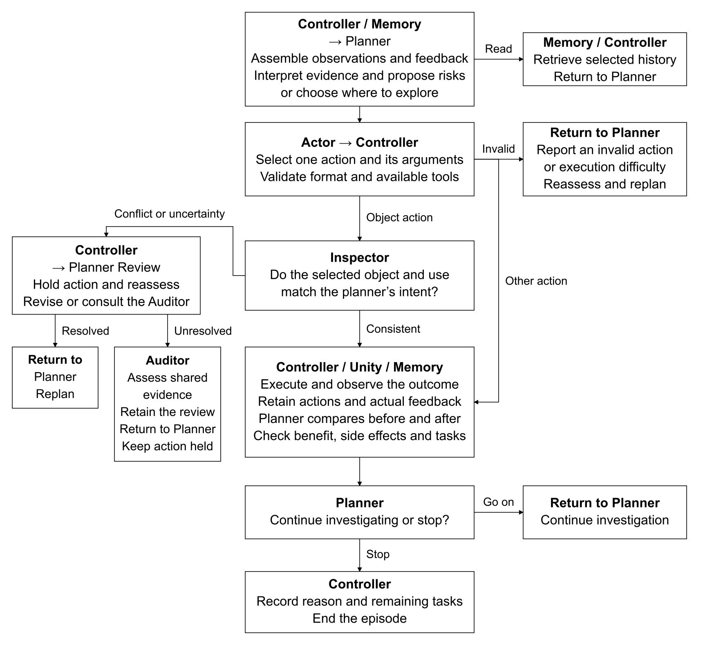

# A Household Safety Agent in AI2-THOR

safety-ai2thor is a research project exploring how a vision-language model can control an embodied agent to identify and address household safety concerns. It uses AI2-THOR, a Unity-based simulator of interactive indoor environments. The agent acts as a virtual robot: it observes the home through a first-person camera, moves through the scene, and interacts with objects such as faucets, refrigerators, and microwaves.

The framework connects visual observations with planning, action selection, memory, and simulator feedback. This repository provides the Python agent, Unity source extensions, and three example scenarios for studying this observation–planning–action–review process.

The source snapshot includes the latest engineering configuration. Historical examples use their original configurations. See [technical_report.md](technical_report.md) for findings and limits.

## Package structure

|Path|Purpose|
|---|---|
|Root Python modules|Planner, Actor, temporary Inspector/Auditor, memory, model inference and execution|
|`tools/run_public_study.py`|Portable entry point with fresh-output protection|
|`examples/cases.json`|Setup for three test scenarios introduced in the [technical_report.md](technical_report.md)|
|`examples/common-arguments.json`|Shared current run configuration|
|`unity_extensions/`, `unity_patches/`|Small source extension and upstream compatibility patch|
|`assets/`|Architecture diagram and selected case frames|
|`third_party/`|Upstream license|

## Architecture



The Planner proposes a concern, an immediate goal, and the overall task. The Actor independently checks the current evidence and selects an action or requests replanning. For object actions, an Inspector checks the selection against the intent; unresolved disagreements can be escalated to a symmetric Auditor. The controller validates tool syntax, parameters, and aliases, records native acknowledgments, and delivers the after-observation. These checks do not certify the meaning or safety of a model decision.

Task, observation, and operation records keep their authorship and identities. Shared records and images are represented once. The optional lossless record table groups repeated field names while preserving values, order, and references. The owned clock pauses scaled simulation time during model inference.

## Requirements

The simulator build supplied here targets **Windows x86_64**. Inference can run in the same controller process with `--llm huggingface`, or on a separate GPU host with `--llm ssh`. The historical development topology used a Windows controller/player and a Linux host with an NVIDIA GPU over SSH. No Linux/macOS player recipe is supplied.

Use Python 3.12. The public upstream project records Unity **2020.3.25f1**; use that exact Editor with Windows Mono build support and follow UNITY_BUILD.md.

Create a separate controller environment:

```powershell
py -3.12 -m venv .venv
.venv/Scripts/python -m pip install -r requirements-controller.txt
```

For **local inference**, add the model dependencies to that same environment:

```powershell
.venv/Scripts/python -m pip install torch==2.9.1+cu126 torchvision==0.24.1+cu126 --index-url https://download.pytorch.org/whl/cu126
.venv/Scripts/python -m pip install -r requirements-inference.txt
.venv/Scripts/python -m pip check
.venv/Scripts/python -B tools/check_inference.py
```

For **SSH inference**, prepare a separate Linux inference environment and copy this package to a directory of your choice, for example `/srv/safety-ai2thor`. Choose paths you can write to. The candidate installation is:

```bash
python3.12 -m venv /srv/safety-ai2thor/.venv
/srv/safety-ai2thor/.venv/bin/python -m pip install torch==2.9.1+cu126 torchvision==0.24.1+cu126 --index-url https://download.pytorch.org/whl/cu126
/srv/safety-ai2thor/.venv/bin/python -m pip install -r /srv/safety-ai2thor/requirements-inference.txt
/srv/safety-ai2thor/.venv/bin/python -m pip check
command -v tmux
test -w /srv/safety-ai2thor
/srv/safety-ai2thor/.venv/bin/python -B /srv/safety-ai2thor/tools/check_inference.py --ssh
```

Install `tmux` on the Linux host if absent. From the controller, verify passwordless SSH and remote `tmux` access (replace `my-gpu` with your SSH host):

```powershell
ssh -T -o BatchMode=yes my-gpu "command -v tmux"
```

Requests and results are saved in `<remote-project>/inference-sessions`; this directory must be writable. To use another location, pass the same absolute path via `--ssh-session-root` when launching and `--session-root` when checking the remote environment.

Install dependencies using the commands above. `requirements-base-captured.txt` is only a historical environment inventory. `pip check` checks dependency compatibility; GPU inference is a separate check.

### Download the model

Use `google/gemma-4-12B-it`, pinned to revision `707f0a3b8a3c7ad586ed01e27eafbad8a27dd0f7`. Obtain model access under its terms.

When `--cache-dir` is omitted, loading uses the Hugging Face cache on the inference host. Its usual root is `~/.cache/huggingface/hub`: on Windows, `C:/Users/<your-user>/.cache/huggingface/hub`. Environment overrides are `HF_HUB_CACHE`, or `HF_HOME/hub`; `XDG_CACHE_HOME` also changes the default HF home. Set environment variables before starting Python. An explicit `--cache-dir` selects the model/processor cache for this run without changing the token location. See the [official cache environment documentation](https://huggingface.co/docs/huggingface_hub/en/package_reference/environment_variables).

For local Windows inference, run the installed environment's executables directly to download to the default/environment-selected cache; no shell activation is required:

```powershell
.venv/Scripts/hf auth login  # Only if Hub authentication is required.
.venv/Scripts/python -c "from huggingface_hub import snapshot_download; print(snapshot_download(repo_id='google/gemma-4-12B-it', revision='707f0a3b8a3c7ad586ed01e27eafbad8a27dd0f7'))"
```

Then omit `--cache-dir` from the run command to use that same cache. To use a different disk, download explicitly into a chosen **Hub cache root**:

```powershell
.venv/Scripts/python -c "from huggingface_hub import snapshot_download; print(snapshot_download(repo_id='google/gemma-4-12B-it', revision='707f0a3b8a3c7ad586ed01e27eafbad8a27dd0f7', cache_dir='D:/safety-ai2thor/model-cache'))"
```

Run with `--cache-dir D:/safety-ai2thor/model-cache`. Both model and processor loading receive that same value. The resulting layout is:

```text
D:/safety-ai2thor/model-cache/
  models--google--gemma-4-12B-it/
    blobs/
    snapshots/
      707f0a3b8a3c7ad586ed01e27eafbad8a27dd0f7/
        config.json
        ... model, tokenizer and processor files ...
```

Pass the cache root (`D:/safety-ai2thor/model-cache`) to `--cache-dir`, not the snapshot path printed by the download command. Use the `cache_dir` download recipe above; `--local-dir` produces a different layout.

For **SSH inference**, log in and download on the Linux host:

```bash
/srv/safety-ai2thor/.venv/bin/hf auth login  # Only if authentication is required.
/srv/safety-ai2thor/.venv/bin/python -c "from huggingface_hub import snapshot_download; print(snapshot_download(repo_id='google/gemma-4-12B-it', revision='707f0a3b8a3c7ad586ed01e27eafbad8a27dd0f7', cache_dir='/srv/safety-ai2thor/model-cache'))"
```

Pass `--cache-dir /srv/safety-ai2thor/model-cache` when launching SSH inference. The remote worker runs offline, so download the complete model first.

Check dependencies and cached model files before running. These checks do not load model weights or test GPU capacity.

Local Windows:

```powershell
.venv/Scripts/python -B tools/check_inference.py --check-cache --cache-dir D:/safety-ai2thor/model-cache
```

Remote Linux:

```bash
/srv/safety-ai2thor/.venv/bin/python -B /srv/safety-ai2thor/tools/check_inference.py --ssh --check-cache --cache-dir /srv/safety-ai2thor/model-cache
```

Omit `--cache-dir` to use the inference host's default cache. Add `--session-root` to the remote check if you configured a custom request/result directory.

## Build the simulator extension

Follow [UNITY_BUILD.md](UNITY_BUILD.md) to apply the source extensions and patch, then build a Windows player containing FloorPlan25 and FloorPlan26. Both scenes are required. A precompiled player is not included; the extensions require rebuilding AI2-THOR from source.

Before building, activate Unity Editor 2020.3.25f1 through Unity Hub and confirm that it launches successfully.

## Run the three cases

Run commands from the package root. Replace the example paths and host name with your own.

Local inference (the default backend):

```powershell
.venv/Scripts/python -B tools/run_public_study.py --llm huggingface --executable D:/safety-ai2thor/build/safety-ai2thor.exe --player-manifest D:/safety-ai2thor/player-manifest.json --source D:/safety-ai2thor/upstream --output runs/faucet-01 --cache-dir D:/safety-ai2thor/model-cache --case 01 --print-command
```

Optional SSH inference:

```powershell
.venv/Scripts/python -B tools/run_public_study.py --llm ssh --executable D:/safety-ai2thor/build/safety-ai2thor.exe --player-manifest D:/safety-ai2thor/player-manifest.json --source D:/safety-ai2thor/upstream --output runs/faucet-ssh-01 --ssh-host my-gpu --ssh-project /srv/safety-ai2thor --ssh-python /srv/safety-ai2thor/.venv/bin/python --ssh-cuda-device 0 --cache-dir /srv/safety-ai2thor/model-cache --case 01 --print-command
```

- `--print-command` previews the command. Remove it to run after preparing the player and model.
- `--source` points to the official AI2-THOR clone containing `ai2thor/controller.py`.
- For SSH, copy the same package to `--ssh-project`. Use `--ssh-session-root` if you configured a custom request/result directory.
- Use a new output path for each run; existing outputs are rejected.

|`--case`|Scene|Initial setup|
|---|---|---|
|`01`|FloorPlan25|Faucet on|
|`02`|FloorPlan26|Refrigerator open|
|`03`|FloorPlan26|Microwave on|

For the other cases, use `--case 02 --output runs/fridge-01` or `--case 03 --output runs/microwave-01`. Each starts with fresh memory and the setup positions the robot and appliance.

The default condition is `M0`. Optional `--condition M1` adds a continuing safety mission; `M2` adds one neutral end review per task.

### Current configuration

The default profile is `gemma12b-int8-rp105-t08`:

|Setting|Value|
|---|---|
|Weights / computation|Quanto INT8 / FP16|
|Sampling|Temperature 0.8; top-p 0.95; top-k 64; seed 20261029|
|Thinking repetition penalty|1.05; prompt and final response excluded|
|Token limits|32,768 input; 16,384 thinking; 20,481 maximum generated|
|Images|Up to eight, each 448 × 448 RGB|
|History|Shared inputs/images and record tables enabled|

`--profile gemma12b-int8` selects temperature 0.6 and repetition penalty 1, which are used in the historical tests.

### Outputs and failure handling

- `runs/<name>/open-discovery-summary.json`: setup and completion status.
- Case subdirectory: checkpoint, model-call journal, RGB images, action results, and clock records.
- Launcher JSON/log beside the output directory: local process and cleanup records.

SSH calls have a two-hour timeout; local inference has no per-call timeout. Both use a twelve-hour launcher timeout. Video export is disabled.

For SSH failures, inspect `<remote-project>/inference-sessions/<session>/worker.log`, request/result files, `worker.claim` and `worker.exited` (or your custom directory). Confirm its state and any action outcome before restarting or deleting records.

## Offline package check

The code below checks file integrity, configuration and command assembly without a GPU or player.

```powershell
.venv/Scripts/python -B tools/check_delivery.py
```

## Validation status

|Check|Result|
|---|---|
|Fresh Windows Python installation|Dependencies, `pip check` and imports passed. Windows GPU execution were untested|
|Package and Python checks|66 content hashes and 18 command combinations passed; 142 regression tests passed. One local CUDA test was skipped|
|Linux SSH/CUDA inference|Real mailbox operation and one pinned 12B image-inference/schema check passed on V100. Existing large dependencies were reused|
|Official Unity source|Pinned clone preparation and standalone C# compilation checks passed. Unity import and Player build were unverified|
|Complete simulator execution|No clean Player/model end-to-end result or maximum-context/eight-image capacity qualification|