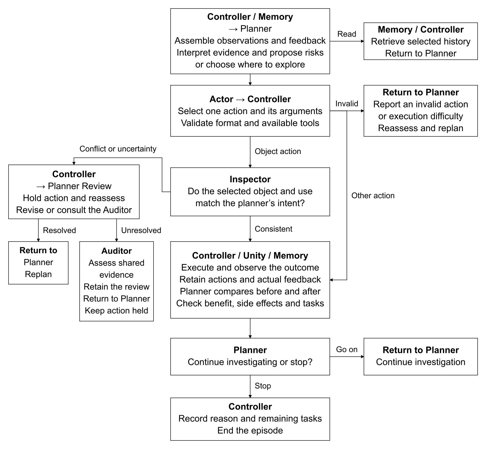
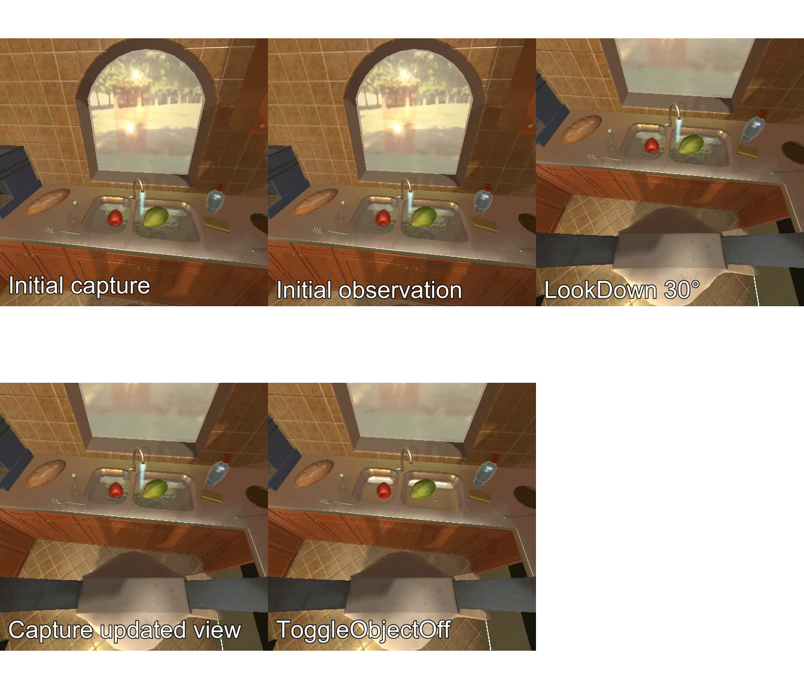
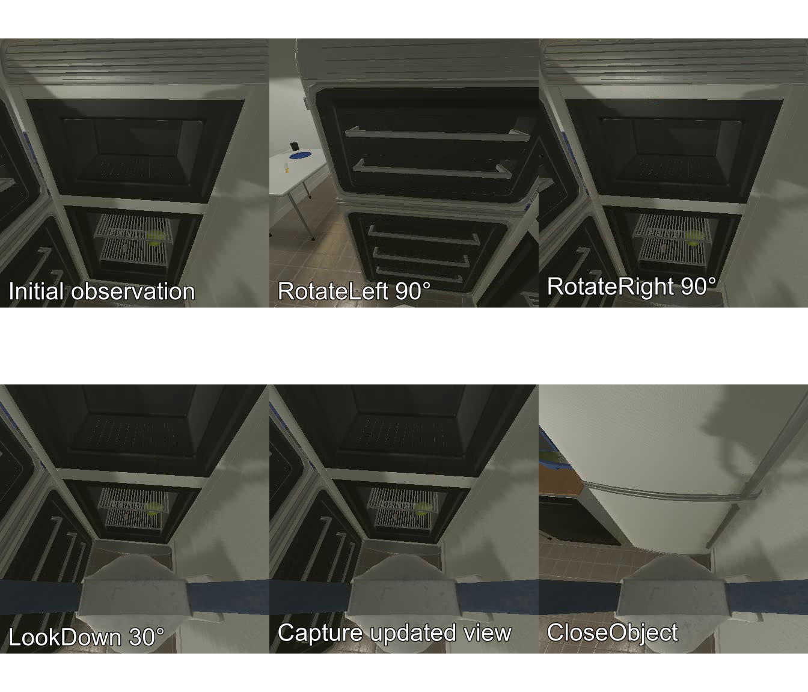

# Household Safety AI2-THOR Engineering Milestone

## 1 Research objective and design

The objective is for a robot to identify a household safety concern, verify its observations, plan and execute an intervention, and assess the outcome. Exploration may precede a risk hypothesis.

The framework connects identified visual observations, hierarchical planning, tool selection, task and operation memory, simulator responses, and environment-time control. Gemma 4 12B uses Quanto INT8 weights and FP16 computation. The evaluator can place the robot in a configured situation to reduce the difficulty of exploration.

The project has reached a partial milestone: a traceable VLM evaluation framework. Two preliminary test cases of local interventions are provided in the repo.

Here is a diagram that describes the workflow implemented in our framework.

## 2 Preliminary Milestone from the Latest Evaluation

**Evaluation purpose:** Three basic cases place a configured situation within the robot’s initial view, reducing the difficulty of exploration while testing whether the model can recognize and address a situation worth investigating.

|Case|Description|
|---|---|
|Case 1 — Running faucet|The model formed a risk hypothesis based on the visible water stream, looked down at the sink area, and turned off the faucet. The simulator reported successful execution and an off state; subsequent visual feedback showed that the stream had disappeared. The model then judged the issue resolved and ended the episode. This case demonstrated a complete sequence of observation, verification, intervention, and assessment. Elapsed time: 40 minutes 2 seconds.|
|Case 2 — Open refrigerator|The attempted closing action failed because the door collided with the robot. The robot successfully moved back once, and the planner proposed further repositioning. The next Actor call was rejected because its decoded reasoning was empty, and the unhandled error terminated the run. Elapsed time: 2 hours 19 minutes. Retry successes in 58 minutes 14 seconds.|
|Case 3 — Switched-on microwave|The model investigated the illuminated microwave display but did not confirm whether the microwave was operating and attempted to approach it but failed multiple times due to physical obstructions. After turning, it briefly lost sight before turning back. Some plans were rejected by the controller because Some proposals were rejected because they selected act while still declaring information required before that step. Ultimately, the trial ended after reaching maximum decision round without turning off the microwave oven. Elapsed time: 2 hour 19 minutes.|

## 3 Decision Making of the System

**System components:** A planner, an actor, a memory system, and an execution controller. AI2-THOR and Unity provide a simulated environment. VLM, Gemma 12B, autonomously makes decisions.

**Planner:** Proposes a problem and the purpose of the next step. Its output includes a hypothesis, an immediate goal, an overall task_goal, plan steps and progress, missing essential information, and a decision to observe, act, or read memory.

**Actor:** Converts the purpose into a concrete action. Each available object candidate has an alias, such as obj_006. A pickup action identifies the object to be lifted; a placement action identifies the receiving container or surface. If the target cannot be found or execution is uncertain, RequestReplan reports the reason for the planner to reconsider.

**Controller:** Validates action names, parameters, and object aliases before dispatching a command. After the simulator returns success or failure with a command identifier, the system acquires a subsequent image. These checks prevent malformed requests.

## 4 Improvements to Memory and Working Context

**Distinguishing current & historical observations:** Each image has a stable observation_id, capture time, position, orientation, and an indication of whether it represents the current view. The separately stored observations and interaction outcomes.

- Task memory: Retaining the original purpose of each task, subsequent plans, and conclusions.

- Operation history: Retaining selected actions, recent observations, and simulator responses.

- Retrieval: When further context is needed, the VLM can retrieve specific archived records.

**Reassembling working context:** The input retains current multimodal observations, the current task and inherited conclusions, the latest actual outcome, and essential communication. Full reasoning is archived for review. The model can retrieve historical images and store tasks and operation records. The same latest feedback is supplied once.

**Provenance:** Within each request, duplicate images and shared data are represented once while preserving their references. while preserving observation identities, reference locations, historical claims, the origin of controller feedback, and actual simulator responses. This separates model claims from environmental evidence.

- Performance: Pointer references to the original images and the actual image processor, and reducing repeated context in the input reduced the input from 32,933 to 14,139 tokens, approximately 57% in one case. In an eight-round input-assembly test, repeated attachment of old feedback no longer caused continued input growth, while original tool information remained exactly retrievable. The effect on the model’s use of memory has not yet been established.

**Self-reinforcing text generation:** In one case, the model repeated “Actually, I’ll just do RotateLeft” 1,195 times within a single generation. Related research documents this mechanism. To mitigate the problem without prescribing the model’s decisions, the temperature is increased from 0.6 to 0.8, and a thinking-only repetition penalty of 1.05 is applied as a new measure to combat clearly degenerate outputs, while excluding prompt tokens and the final response from the penalty.

## 5 Execution Outcomes Management

**Environment time:** The controller freezes simulation time during inference to prevent time lapses.

**Execution outcomes:** Records distinguish commands not yet sent / received simulator result / may have been executed without known results (no automatic resend). If any image capture or persistence fails after an action result has arrived, both the error and the related result are retained.

**Pre-execution qualification:** Checks cover image and text delivery to the model, simulator functionality with optional GPU capacity at the full budget, held-object rendering opacity, and per-pixel distance information.

## 6 Independent Review

**Independent selection inspection:** An inspector compares the selected object and its proposed use with the planner’s intent for a valid object action. If an unsettled conflict of recognition or uncertain selection between planner and actor is raised, evidence will be forwarded to an auditor.

**Fair review:** Earlier tests showed that task intent and advocacy could influence the auditor. Candidate names are now presented symmetrically without proposer identities, making construction symmetric under label exchange.

## 7 Main Findings from Experimental History

**Model capacity and memory:** Development progressed from Qwen3.5 2B to 9B, followed by Gemma 4 12B integration. Paired inputs showed that historical images could support some interpretations. Remaining failures included incorrect observation-ID bindings, references to nonexistent fields, and self-defined verification criteria without supporting observations.

**Intervention and task closure:** Earlier experiments showed the ability to close a refrigerator and place a ladle in a drawer, with the local corrections supported by memory (e.g., reading history corrected a mistaken belief that the robot could not release a held object).

**Object recognition and feedback:** However, recognition errors remained. Even when simulator feedback supplied an object type, the actor could still judge it consistently with the intended object and pick it up, or misidentify objects held. These cases did not establish a reasonable complete loop. Object-recognition accuracy has not been established.

## 8 Generation Latency

**Current budget:** 32,768 input tokens, 16,384 thinking tokens, 20,481 maximum output tokens, and up to eight 448 × 448 RGB images. Reaching the thinking limit triggers a transition to the final response, which must still pass format and reference checks.

**Generation latency:** Most delay occurs during generation. In one specific snapshot, the first planner call used all 16,384 thinking tokens and took approximately 62.5 minutes; subsequent planner calls took approximately 6.6–10.9 minutes.

## 9 Questions for the Next Stage

**Complete safety interventions:** After success in nearby scenarios, evaluate whether the model can independently form and complete an intervention loop at intermediate and longer distances.

**Memory, revision, and feedback:** Examine whether the model retrieves relevant history when observations conflict, revises object-identity and capability judgments, and uses actual execution outcomes in subsequent decisions, and ensure that the environment feedback is reasonably precise.

**Image.** The captured frames during the test Case 1 (Running Faucet)

**Image.** The captured frames during the retried test Case 2 (Open Refrigerator)

